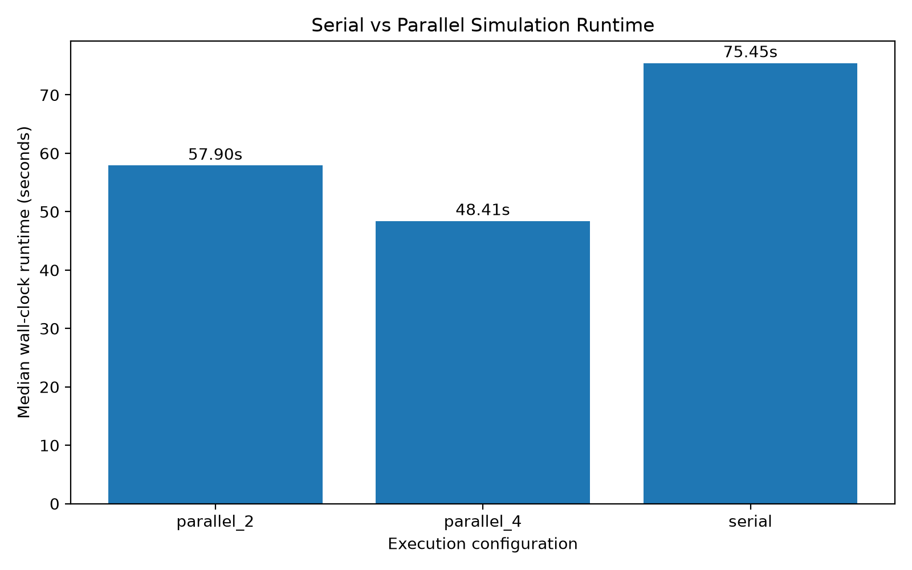

# STATS 607 Unit 3 Project — High-Performance Simulation Study

## Overview

This project improves the computational efficiency of the Lasso signed-support recovery simulation developed for the STATS 607 Unit 2 Project.

The original simulation reproduces Figure 2 of Wainwright (2009), investigating sharp thresholds for exact signed-support recovery in high-dimensional linear regression.

The Unit 3 project focuses on computational profiling, complexity analysis, algorithmic improvements, parallel execution, numerical stability, and reproducible performance benchmarking.

The original statistical design and research questions are preserved.

## Simulation Design

The experiment follows the Gaussian linear regression design described in Wainwright (2009).

- **Dimensions:** p = 128, 256, 512
- **Sparsity regimes:** Linear, sublinear, and fractional-power
- **Signal strength:** Nonzero coefficients equal to +0.5 or -0.5
- **Noise standard deviation:** 0.5
- **Rescaled sample size:** 14 theta values from 0.2 to 2.4
- **Monte Carlo replications:** 200 per scenario
- **Total:** 126 scenarios and 25,200 Lasso fits
- **Master random seed:** 6072026

The complete experimental design is documented in [ADEMP.md](ADEMP.md). The statistical results and comparison with the original paper are discussed in [ANALYSIS.md](ANALYSIS.md).

## Optimization Strategies

Two optimization categories were implemented.

### 1. Algorithmic Improvements — Eliminating Redundant Computations

The original implementation repeatedly converted scenario parameters and recalculated the Lasso regularization parameter for each replication.

The updated implementation caches scenario-specific parameters and computes the regularization parameter once per scenario.

Profiling confirmed that `calculate_lambda()` calls decreased from 25,200 to 126, a 99.5% reduction.

However, this operation accounted for only a small fraction of the original runtime, and the available benchmarks did not demonstrate a meaningful whole-program speedup from this change alone.

### 2. Parallelization — Scenario-Level Multiprocessing

A parallel implementation was introduced in `src/parallel.py` using Python's `ProcessPoolExecutor`.

Independent simulation scenarios are distributed across worker processes while preserving deterministic random-stream assignment and output ordering.

Both 2-worker and 4-worker configurations were evaluated.

### Additional Optimization Experiments

Sparse-support matrix multiplication and Fortran-contiguous memory layout were also investigated.

Although these approaches had theoretical or local computational advantages, neither demonstrated a convincing improvement in the full simulation. Both modifications were therefore rejected.

For detailed implementations, profiling evidence, benchmarks, and trade-offs, see [Optimization Analysis](docs/OPTIMIZATION.md).

## Requirements

- Python 3.11 or a compatible Python 3 version
- GNU Make or a compatible `make` implementation
- NumPy, pandas, scikit-learn, matplotlib, and pytest

All dependencies should be installed from `requirements.txt`.

## Setup

Clone the Unit 3 repository:

```bash
git clone https://github.com/cyongxi/stats607-unit3-project.git
cd stats607-unit3-project
```

Create and activate a virtual environment:

```bash
python3 -m venv .venv
source .venv/bin/activate
```

Install dependencies:

```bash
python -m pip install -r requirements.txt
```

## Running the Project

### Original Simulation Pipeline

Run the serial simulation, analysis, and figure generation:

```bash
make all
```

Individual commands:

```bash
make simulate
make analyze
make figures
```

**Note:** `make simulate` uses the updated serial implementation with scenario-level parameter precomputation, not the exact original Unit 2 implementation. The unmodified original implementation is preserved in the Git baseline history.

### Unit 3 Performance Commands

| Command | Description |
|---|---|
| `make profile` | Profile the updated serial simulation using cProfile |
| `make complexity` | Analyze empirical computational scaling |
| `make benchmark` | Benchmark serial and parallel configurations |
| `make parallel` | Run the 4-worker parallel simulation |
| `make stability-check` | Examine numerical warnings and convergence diagnostics |
| `make test` | Run the automated correctness and regression tests |
| `make pilot` | Run a small serial pilot study |

The performance benchmark repeats the serial, 2-worker, and 4-worker configurations three times and saves the resulting timing summaries and visualization.

The benchmark uses a single BLAS thread per process to provide a consistent thread configuration across runs.

## Performance Results

### Original Serial Baseline

The unmodified Unit 2 simulation was measured three times:

| Run | Runtime |
|---|---:|
| 1 | 76.97 s |
| 2 | 73.75 s |
| 3 | 73.70 s |

**Median baseline runtime: 73.75 seconds.**

These measurements cover the simulation stage, not the complete analysis and figure-generation pipeline.

### Repeated Optimization Benchmark

The following results are from three repeated runs per configuration.

| Configuration | Median runtime | Speedup |
|---|---:|---:|
| Updated serial | 75.45 s | 1.00× |
| Parallel, 2 workers | 57.90 s | 1.30× |
| Parallel, 4 workers | 48.41 s | **1.56×** |

The 4-worker implementation reduced median wall-clock runtime by approximately 35.8% relative to the updated serial implementation.

An earlier single-run experiment observed a 29.80-second runtime for the combined 4-worker implementation, but the repeated benchmark is used as the primary performance comparison because runtime variability was substantial.

The updated serial configuration includes lambda precomputation. Therefore, the repeated benchmark measures the additional benefit of parallelization relative to the updated serial version.

### Runtime Comparison



### Computational Complexity

An empirical complexity analysis was performed with fixed p = 256 and k = 103, varying sample size n.

The estimated log-log scaling exponents were:

| Component | Empirical exponent |
|---|---:|
| Data generation | 0.968 |
| Lasso fitting | 0.406 |
| Combined runtime | 0.585 |

These values describe empirical scaling over the tested range and should not be interpreted as general theoretical complexity bounds.


Detailed methodology and baseline findings are available in [Baseline Performance Analysis](docs/BASELINE.md).

## Correctness and Numerical Stability

The project contains 15 automated tests covering:

- Data generation and reproducibility
- Regularization parameter calculation
- Lasso estimation
- Signed-support recovery
- Serial-parallel numerical equivalence

Run the test suite:

```bash
make test
```

All 15 automated tests passed.

Full-simulation regression checks compared 25,200 records from the original and optimized implementations, with numerical tolerance `rtol=1e-10` and `atol=1e-10`.

The comparisons confirmed equivalence of recorded simulation outputs within the specified tolerances.

A separate numerical stability check covered 270 simulation runs across selected scenarios and observed:

- 0 warnings
- 0 convergence warnings
- 0 exceptions
- 0 runs reaching the iteration limit
- 0 non-finite duality gaps

These stability results describe the sampled scenarios rather than every possible simulation setting.

## Project Structure

```text
stats607-unit3-project/
├── src/
│   ├── scenarios.py
│   ├── dgps.py
│   ├── methods.py
│   ├── metrics.py
│   ├── simulation.py
│   ├── parallel.py
│   ├── analyze.py
│   └── figures.py
├── scripts/
│   ├── complexity.py
│   ├── benchmark.py
│   └── stability_check.py
├── tests/
│   ├── test_dgps.py
│   ├── test_methods.py
│   ├── test_metrics.py
│   └── test_regression.py
├── docs/
│   ├── BASELINE.md
│   └── OPTIMIZATION.md
├── results/
│   ├── raw/
│   ├── profiling/
│   ├── benchmarks/
│   └── figures/
├── ADEMP.md
├── ANALYSIS.md
├── Makefile
├── requirements.txt
└── README.md
```

Generated raw simulation files and binary profiler outputs may be excluded from Git because they can be reproduced using the provided commands.

## Main Outputs

| File | Description |
|---|---|
| `docs/BASELINE.md` | Original runtime, complexity, profiling, and numerical diagnostics |
| `docs/OPTIMIZATION.md` | Optimization implementation, benchmarks, trade-offs, and validation |
| `results/benchmarks/optimization_benchmark_raw.csv` | Individual benchmark timings |
| `results/benchmarks/optimization_benchmark_summary.csv` | Runtime summaries and speedup ratios |
| `results/figures/optimization_runtime_comparison.png` | Serial-parallel runtime comparison |
| `results/figures/baseline_complexity.png` | Empirical computational complexity visualization |
| `results/benchmarks/stability_check_results.csv` | Sampled numerical stability diagnostics |
| `results/raw/simulation_results.csv` | Generated serial replication-level results |
| `results/raw/parallel_results.csv` | Generated parallel replication-level results |

## Key Findings

Scenario-level parallelization provided the most substantial improvement in computational efficiency, reducing the median simulation runtime by approximately 35.8% in the repeated benchmark.

Lambda precomputation successfully eliminated redundant calculations but did not produce a meaningful standalone improvement in overall runtime.

Sparse-support multiplication and Fortran-contiguous memory layout demonstrated that theoretical or isolated computational improvements do not necessarily translate into faster end-to-end execution.

Overall, the project illustrates the importance of profiling, representative benchmarking, numerical verification, and reproducible optimization.

## Reference

Wainwright, M. J. (2009). Sharp thresholds for high-dimensional and noisy sparsity recovery using L1-constrained quadratic programming (Lasso). *IEEE Transactions on Information Theory, 55*(5), 2183–2202.