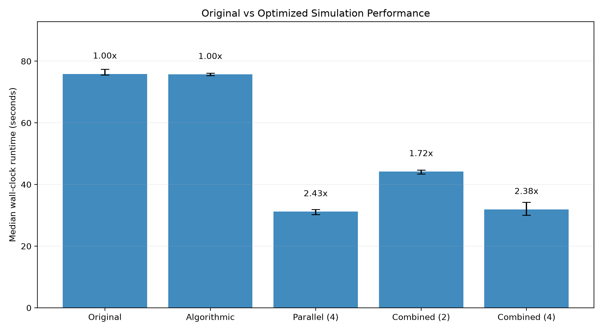
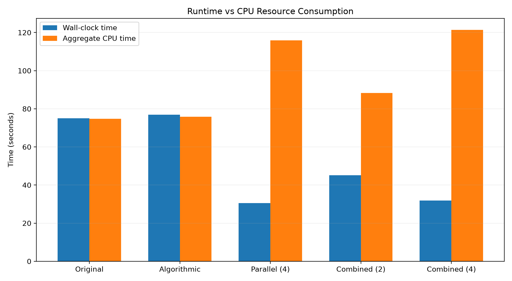
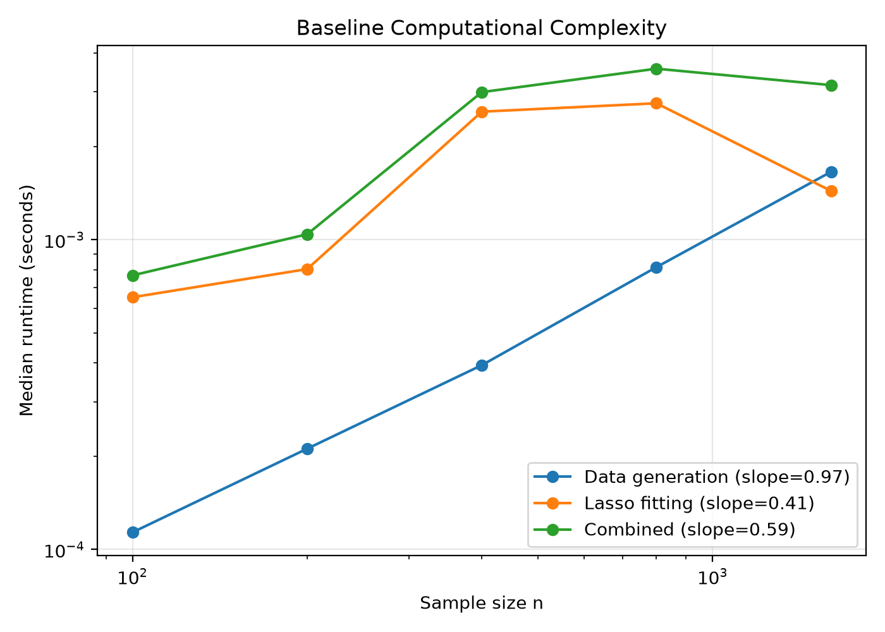

# STATS 607 Unit 3 Project — High-Performance Simulation Study

## Overview

This project optimizes the Lasso signed-support recovery simulation developed for the STATS 607 Unit 2 Project.

The original study reproduces Figure 2 of Wainwright (2009), which investigates thresholds for exact signed-support recovery in high-dimensional linear regression.

Unit 3 focuses on profiling, empirical runtime scaling, elimination of redundant computations, multiprocessing, numerical stability, and reproducible benchmarking.

The statistical design is preserved. The main objective is to reduce simulation completion time while maintaining agreement with the original simulation outputs.

In the controlled benchmark, the combined four-worker implementation reduced median wall-clock time from **75.07 to 31.87 seconds**, achieving **2.36× speedup** and a **57.5% reduction in elapsed time**, with increased aggregate CPU consumption.

## Simulation Design

| Parameter | Setting |
|---|---|
| Dimensions | $p = 128, 256, 512$ |
| Sparsity regimes | Linear, sublinear, and fractional-power |
| Nonzero coefficients | +0.5 or −0.5 |
| Noise standard deviation | 0.5 |
| Rescaled sample size | 14 values of $\theta$ from 0.2 to 2.4 |
| Monte Carlo replications | 200 per scenario |
| Total workload | 126 scenarios and 25,200 Lasso fits |
| Master random seed | 6072026 |

The complete design, including sparsity formulas, sample-size scaling, and regularization parameters, is documented in [ADEMP.md](ADEMP.md).

Statistical results and comparisons with the paper are discussed in [ANALYSIS.md](ANALYSIS.md).

## Optimization Strategies

### 1. Elimination of Redundant Computations

The original implementation repeatedly extracted scenario parameters and recalculated the Lasso regularization parameter within the replication loop.

The regularization parameter is:

$$
\lambda_n =
\sqrt{\frac{2\sigma^2\log(k)\log(p-k)}{n}}.
$$

Because its inputs are constant within a scenario, the updated implementation calculates it once per scenario and reuses it across replications.

The changes are implemented in `src/simulation.py` and `src/methods.py`. An optional precomputed `lam` argument preserves compatibility with existing calls to `fit_lasso()`.

Profiling confirmed that calls to `calculate_lambda()` decreased from 25,200 to 126, a **99.5% reduction**.

This change reduces redundant work but does not change the dominant asymptotic complexity or the number of Lasso fits. The controlled benchmark did not demonstrate an end-to-end serial speedup: the algorithmic-only median was 76.83 seconds, compared with 75.07 seconds for the original implementation.

Precomputation was retained for reduced redundancy and clearer organization, without claiming a measured runtime benefit.

### 2. Scenario-Level Multiprocessing

Independent scenarios are distributed across worker processes using `ProcessPoolExecutor` in `src/parallel.py`.

The implementation preserves deterministic assignment of random streams to scenario-replication pairs and returns results in scenario order.

Worker counts are configurable through the `--workers` command-line argument. Both two-worker and four-worker configurations were evaluated.

The main measured improvement comes from concurrent execution of independent tasks. The total number of generated datasets and Lasso fits remains unchanged.

### 3. Additional Experiments

Two candidate modifications were evaluated but not retained:

- **Sparse-support matrix multiplication:** Reduced arithmetic in the response calculation, but advanced indexing and intermediate-array operations made the tested implementation slower.
- **Fortran-contiguous memory layout:** Produced small improvements in local conversion-and-fitting benchmarks but did not demonstrate a convincing full-simulation benefit.

See [Optimization Implementation and Performance Analysis](docs/OPTIMIZATION.md) for implementation details, experimental results, and trade-offs.

## Requirements

- Python 3.11; the reported benchmark used Python 3.11.1.
- GNU Make or a compatible `make` implementation.
- macOS with `/usr/bin/time -p` for the tested controlled benchmark automation.

Python dependencies are listed in `requirements.txt` and include NumPy, pandas, scikit-learn, Matplotlib, and pytest.

### Recorded Benchmark Environment

The following versions were recorded for the reported measurements:

| Component | Version |
|---|---|
| Python | 3.11.1 |
| NumPy | 2.4.6 |
| pandas | 3.1.0 |
| scikit-learn | 1.9.1 |
| Matplotlib | 3.11.2 |

`requirements.txt` does not pin these exact versions. A fresh installation may therefore resolve a different environment; installing dependencies alone does not guarantee reproduction of the recorded package versions or timings.

## Setup

Clone the repository:

```bash
git clone https://github.com/cyongxi/stats607-unit3-project.git
cd stats607-unit3-project
```

Create and activate a virtual environment:

```bash
python3 -m venv .venv
source .venv/bin/activate
```

Install dependencies:

```bash
python -m pip install -r requirements.txt
```

Run subsequent commands from the repository root with the environment activated.

## Running the Project

### Serial Simulation and Analysis

Run the updated serial simulation, analysis, and figure generation:

```bash
make all
```

Run individual stages:

```bash
make simulate
make analyze
make figures
```

Run a small serial pilot:

```bash
make pilot
```

`make simulate` executes the updated Unit 3 serial implementation with scenario-level precomputation. The unmodified Unit 2 baseline is preserved separately at Git tag `unit3-baseline`.

### Tests and Performance Commands

| Command | Purpose |
|---|---|
| `make test` | Run the 27-test automated suite |
| `make regression-baseline` | Compare 27 records across nine representative scenarios from the original and updated serial implementations |
| `make parallel` | Run the combined four-worker simulation |
| `make profile` | Profile the updated serial simulation |
| `make complexity` | Analyze empirical runtime scaling |
| `make benchmark` | Run the controlled benchmark |
| `make benchmark-report` | Regenerate benchmark summaries and figures from existing measurements |
| `make stability-check` | Examine warnings, convergence, and numerical diagnostics |

Remove generated simulation results and figures:

```bash
make clean
```

## Reproducing the Controlled Benchmark

### 1. Prepare the Original Baseline

The original unmodified implementation is preserved at Git tag `unit3-baseline` (commit `ededf3b`).

Fetch the tag if necessary:

```bash
git fetch origin tag unit3-baseline
```

Create a separate baseline worktree alongside the main repository:

```bash
git worktree add --detach ../stats607-unit3-baseline unit3-baseline
```

The expected locations are:

| Directory | Purpose |
|---|---|
| `stats607-unit3-project/` | Updated Unit 3 source and virtual environment |
| `stats607-unit3-baseline/` | Original Unit 2 source at the baseline tag |

Both implementations use the Python interpreter from the main project's virtual environment. The benchmark checks that the baseline worktree points to the expected commit.

### 2. Run the Benchmark

```bash
make benchmark
```

The benchmark evaluates five configurations:

1. **Original:** Unmodified Unit 2 serial implementation.
2. **Algorithmic-only:** Updated serial implementation with scenario-level parameter and lambda precomputation.
3. **Parallel-only (4 workers):** Parallel implementation without lambda precomputation, retaining some scenario-level parameter caching.
4. **Combined (2 workers):** Parallel execution with lambda precomputation.
5. **Combined (4 workers):** Parallel execution with lambda precomputation.

The parallel-only implementation is in `src/parallel_only.py`. Because it retains some parameter caching, it does not completely isolate every algorithmic modification.

Each configuration runs three times, with a rotating configuration order across repetitions. Each run performs 25,200 Lasso fits, giving 15 full-simulation runs in total.

The benchmark applies these numerical-library thread limits:

```text
OPENBLAS_NUM_THREADS=1
OMP_NUM_THREADS=1
MKL_NUM_THREADS=1
```

Measurements use `/usr/bin/time -p` to record elapsed, user CPU, and system CPU time.

### 3. Regenerate Reports

To regenerate summaries and figures without collecting new measurements:

```bash
make benchmark-report
```

This requires:

`results/benchmarks/controlled_benchmark_raw.csv`

The benchmark automation was developed and tested on macOS. Portability to other operating systems has not been established.

## Performance Results

### Controlled Benchmark

All configurations used the same Python environment, simulation design, master seed, and numerical-library thread limits.

The original baseline wall-clock measurements were 74.75, 75.07, and 76.88 seconds, giving a median of **75.07 seconds**.

| Configuration | Median wall time (s) | Median aggregate CPU time (s) | Speedup | Runtime reduction |
|---|---:|---:|---:|---:|
| Original | 75.07 | 74.78 | 1.000× | 0.0% |
| Algorithmic-only | 76.83 | 75.80 | 0.977× | −2.3% |
| Parallel-only (4 workers) | 30.50 | 115.86 | 2.461× | 59.4% |
| Combined (2 workers) | 45.10 | 88.25 | 1.665× | 39.9% |
| Combined (4 workers) | 31.87 | 121.35 | 2.356× | 57.5% |

Speedup is calculated from median wall-clock times:

$$
S_c = \frac{T_{\mathrm{original}}}{T_c}.
$$

These measurements cover the simulation stage, excluding subsequent statistical analysis and figure generation.

The combined four-worker implementation achieved approximately **2.36× speedup**, reducing elapsed time by **57.5%**.

The parallel-only four-worker configuration had the lowest observed median runtime overall. The measurements provide no evidence of an additional runtime benefit from lambda precomputation.

The algorithmic-only median was approximately 2.3% higher than the original median. Three repetitions per configuration are insufficient to establish a reliable small performance difference or a systematic slowdown.

### Runtime Visualization



The figure shows median wall-clock times. Error bars represent the observed minimum-to-maximum range across three repetitions; they are not confidence intervals.

### CPU Resource Trade-off

Aggregate CPU time is calculated as `user + sys` for each run, followed by the median across runs.

Relative to the original implementation:

- **Combined, two workers:** 39.9% shorter elapsed time and approximately 18.0% more aggregate CPU time.
- **Combined, four workers:** 57.5% shorter elapsed time and approximately 62.3% more aggregate CPU time.



For $w$ workers, efficiency relative to the original serial baseline is:

$$
E_w = \frac{T_{\mathrm{original}}}{wT_w}.
$$

| Configuration | Speedup | Efficiency relative to original baseline |
|---|---:|---:|
| Combined (2 workers) | 1.665× | 83.2% |
| Combined (4 workers) | 2.356× | 58.9% |

These efficiencies compare against the original serial implementation. They are not pure scaling measurements of an otherwise identical parallel implementation.

Among the combined configurations, four workers completed faster. Two workers consumed less aggregate CPU time and achieved higher efficiency relative to the original baseline.

### Empirical Runtime Scaling

An empirical analysis examined runtime scaling as sample size increased.

| Component | Measured log-log exponent |
|---|---:|
| Data generation | 0.968 |
| Lasso fitting | 0.406 |
| Combined runtime | 0.585 |

These exponents describe measured behavior over the tested range. They are not universal theoretical complexity bounds.



See [Baseline Performance Analysis](docs/BASELINE.md) for the methodology.

### Interpretation and Limitations

The controlled benchmark used consistent software and thread settings, with a rotating configuration order to reduce systematic ordering effects.

The experiment was not fully randomized and included only three measurements per configuration. Timings may still depend on scheduling, processor frequency, thermal behavior, background workloads, and resource contention.

The reported speedups are empirical results for the tested environment. Earlier exploratory timings are retained separately and are not used to calculate the final controlled speedups.

## Correctness and Numerical Stability

### Automated Tests

The project includes 27 automated tests covering:

- Data generation and reproducibility.
- Regularization-parameter calculations.
- Lasso fitting and output validation.
- Signed-support recovery.
- Numerical consistency.
- Serial-parallel equivalence.
- Equivalence between internally calculated and precomputed regularization parameters.
- Representative simulation scenarios across sparsity regimes and problem dimensions.
- Statistical summary calculations, including recovery probabilities and Monte Carlo standard errors.
- End-to-end analysis and figure generation.

Run:

```bash
make test
```

All 27 tests passed in the recorded test run.

### Full-Simulation Comparisons

Additional regression checks compared 25,200 replication-level records from the original and optimized implementations.

The comparisons examined identifiers, recovery outcomes, regularization parameters, iteration counts, and duality gaps.

Numerical comparisons used:

```python
pd.testing.assert_frame_equal(
    baseline,
    optimized,
    check_exact=False,
    rtol=1e-10,
    atol=1e-10,
)
```

The recorded outputs agreed within the stated tolerances. This supports preservation of the recorded results for the tested simulation design.

### Reproducible Baseline Regression Check

`scripts/validate_baseline.py` provides a lightweight original-versus-updated serial comparison.

It runs the baseline at `unit3-baseline` and the updated Unit 3 serial implementation in separate Python processes using the same interpreter, master seed, and scenario selection.

Nine representative scenarios cover the three sparsity regimes, problem dimensions $p = 128, 256, 512$, and selected values of $\theta$. With three replications per scenario, the resulting 27 records are compared using `pandas.testing.assert_frame_equal()` with `rtol=1e-10` and `atol=1e-10`.

Run:

```bash
make regression-baseline
```

The command requires the baseline worktree at:

`../stats607-unit3-baseline`

All 27 records agreed in the recorded validation run.

This target complements the previously completed full-simulation comparison. It does not itself validate all 25,200 records and is separate from the default test suite.

### Numerical Stability

Run the sampled stability check:

```bash
make stability-check
```

The recorded check evaluated 27 selected scenarios with 10 replications each:

| Diagnostic | Count |
|---|---:|
| Total runs | 270 |
| Warnings | 0 |
| Convergence warnings | 0 |
| Exceptions | 0 |
| Runs reaching maximum iterations | 0 |
| Non-finite duality gaps | 0 |

No numerical or convergence problems were observed in these sampled runs. This does not establish that problems are impossible in other settings.

## Project Structure

| Location | Contents |
|---|---|
| `src/scenarios.py` | Simulation scenarios |
| `src/dgps.py` | Data generation |
| `src/methods.py` | Lasso estimation and regularization |
| `src/metrics.py` | Recovery metrics |
| `src/simulation.py` | Updated serial simulation |
| `src/parallel.py` | Combined parallel implementation |
| `src/parallel_only.py` | Parallel implementation without lambda precomputation |
| `src/analyze.py` | Statistical summaries |
| `src/figures.py` | Statistical figures |
| `scripts/complexity.py` | Empirical runtime-scaling analysis |
| `scripts/benchmark.py` | Controlled benchmark automation |
| `scripts/plot_controlled_benchmark.py` | Benchmark reports and figures |
| `scripts/stability_check.py` | Numerical stability checks |
| `scripts/validate_baseline.py` | Lightweight baseline regression comparison |
| `tests/` | Automated correctness, regression, and analysis-pipeline tests |
| `tests/test_regression.py` | Representative scenario and serial-parallel regression tests |
| `tests/test_analysis_pipeline.py` | Statistical summaries, validation, and end-to-end analysis tests |
| `docs/` | Baseline and optimization reports |
| `results/` | Generated simulations, diagnostics, benchmarks, and figures |
| `ADEMP.md` | Experimental design |
| `ANALYSIS.md` | Statistical interpretation |
| `Makefile` | Workflow automation |
| `requirements.txt` | Python dependencies |

Generated raw simulation files and binary profiler outputs are excluded from Git because they can be regenerated. Benchmark measurements, summaries, figures, and documentation provide the recorded performance evidence.

## Main Outputs

### Documentation and Controlled Benchmark

| File | Description |
|---|---|
| `docs/BASELINE.md` | Baseline profiling, runtime, scaling, and diagnostics |
| `docs/OPTIMIZATION.md` | Implementation details, experiments, and trade-offs |
| `results/benchmarks/controlled_benchmark_raw.csv` | Individual timing records |
| `results/benchmarks/controlled_benchmark_summary.csv` | Runtime, CPU, speedup, and reduction summaries |
| `results/figures/controlled_runtime_comparison.png` | Controlled runtime comparison |
| `results/figures/controlled_cpu_tradeoff.png` | Elapsed-time and CPU comparison |
| `results/figures/baseline_complexity.png` | Empirical runtime-scaling figure |

### Simulation and Diagnostics

| File | Description |
|---|---|
| `results/raw/simulation_results.csv` | Serial replication-level results |
| `results/raw/parallel_results.csv` | Parallel replication-level results |
| `results/recovery_summary.csv` | Recovery probabilities and Monte Carlo standard errors |
| `results/benchmarks/stability_check_results.csv` | Sampled stability diagnostics |
| `results/benchmarks/stability_check_issues.csv` | Recorded numerical issues, if any |

### Historical Benchmark Outputs

Earlier exploratory results are retained separately:

| File | Description |
|---|---|
| `results/benchmarks/optimization_benchmark_raw.csv` | Exploratory timing measurements |
| `results/benchmarks/optimization_benchmark_summary.csv` | Exploratory performance summary |
| `results/figures/optimization_runtime_comparison.png` | Exploratory runtime comparison |

These files are historical evidence rather than the primary basis for the final reported speedup.

## Key Findings

1. **Parallelization produced the main measured improvement.** The combined four-worker implementation reduced median elapsed time from 75.07 to 31.87 seconds.

2. **Precomputation removed redundancy without demonstrating a runtime benefit.** Lambda calculations decreased by 99.5%, but the dominant workload remained data generation and Lasso fitting.

3. **Faster completion required more CPU resources.** The combined four-worker configuration increased median aggregate CPU time by approximately 62.3%. Two workers offered lower CPU consumption and higher efficiency relative to the original baseline.

4. **Local improvements required whole-program evaluation.** Sparse-support multiplication and Fortran-contiguous storage were not retained because the available measurements did not establish a full-simulation benefit.

5. **Correctness comparisons supported the optimization results.** Automated tests and regression comparisons supported agreement with the original outputs, while sampled diagnostics found no numerical problems in the checked scenarios.

## Reference

Wainwright, M. J. (2009). Sharp thresholds for high-dimensional and noisy sparsity recovery using L1-constrained quadratic programming (Lasso). *IEEE Transactions on Information Theory, 55*(5), 2183–2202.