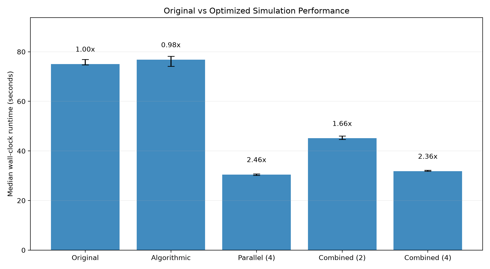
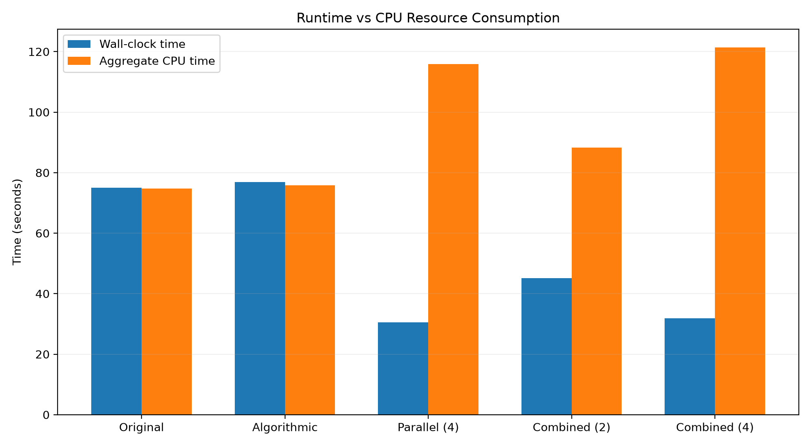
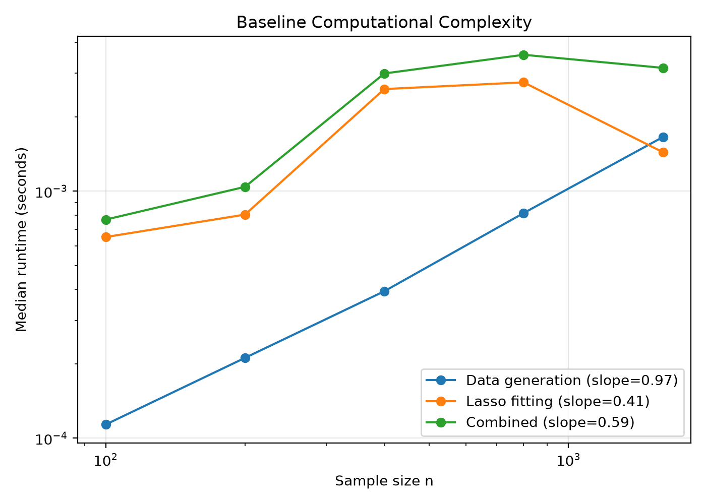

# STATS 607 Unit 3 Project — High-Performance Simulation Study

## Overview

This project improves the computational efficiency of the Lasso signed-support recovery simulation developed for the STATS 607 Unit 2 Project.

The original simulation reproduces Figure 2 of Wainwright (2009), which investigates sharp thresholds for exact signed-support recovery in high-dimensional linear regression.

The Unit 3 project focuses on computational profiling, empirical complexity analysis, algorithmic improvements, parallel execution, numerical stability, and reproducible performance benchmarking.

The original statistical design and research questions are preserved. The main objective is to reduce simulation runtime without changing the statistical results.

## Simulation Design

The experiment follows the Gaussian linear regression design described in Wainwright (2009).

- **Dimensions:** \(p = 128, 256, 512\)
- **Sparsity regimes:** Linear, sublinear, and fractional-power
- **Signal strength:** Nonzero coefficients equal to +0.5 or -0.5
- **Noise standard deviation:** 0.5
- **Rescaled sample size:** 14 values of theta from 0.2 to 2.4
- **Monte Carlo replications:** 200 per scenario
- **Total:** 126 scenarios and 25,200 Lasso fits
- **Master random seed:** 6072026

The complete experimental design, including sparsity formulas, sample-size scaling, and regularization parameters, is documented in [ADEMP.md](ADEMP.md).

The statistical results and comparison with the original paper are discussed in [ANALYSIS.md](ANALYSIS.md).

## Optimization Strategies

Two optimization categories were implemented: algorithmic improvements and parallelization.

### 1. Algorithmic Improvements — Eliminating Redundant Computations

The original implementation repeatedly extracted scenario parameters and recalculated the Lasso regularization parameter for every Monte Carlo replication.

However, the regularization parameter

\[
\lambda_n =
\sqrt{\frac{2\sigma^2\log(k)\log(p-k)}{n}}
\]

depends only on scenario-specific parameters.

The optimized implementation calculates these parameters once per scenario and reuses them across replications.

The implementation modifies `src/simulation.py` and `src/methods.py`, while preserving compatibility with existing calls to `fit_lasso()`.

Profiling confirmed that `calculate_lambda()` calls decreased from 25,200 to 126, representing a 99.5% reduction.

However, controlled benchmarking showed that this optimization produced a negligible improvement in overall runtime because regularization-parameter calculation accounted for only a small fraction of the original computational workload.

### 2. Parallelization — Scenario-Level Multiprocessing

The original simulation executes all 126 scenarios sequentially.

Since the Monte Carlo scenarios are independent, the workload is suitable for parallel execution.

A parallel implementation was introduced in `src/parallel.py` using Python's `ProcessPoolExecutor`.

Independent scenarios are distributed across worker processes while preserving deterministic random-stream assignment and output ordering.

The implementation supports configurable worker counts using the `--workers` command-line argument.

Both two-worker and four-worker configurations were evaluated.

The primary optimization benefit comes from executing independent simulation tasks concurrently rather than reducing the number of Lasso fits.

### 3. Additional Optimization Experiments

Two additional strategies were investigated.

**Sparse-support matrix multiplication:** This approach attempted to exploit the sparsity of the true coefficient vector to reduce the number of arithmetic operations. However, NumPy advanced-indexing overhead made the tested implementation slower.

**Fortran-contiguous memory layout:** This approach investigated whether column-major matrix storage could improve scikit-learn's coordinate-descent performance. Although some microbenchmarks showed small improvements, the full simulation did not demonstrate a convincing performance benefit.

Neither modification was retained.

Detailed implementation decisions, profiling results, and trade-offs are documented in [Optimization Analysis](docs/OPTIMIZATION.md).

## Requirements

- Python 3.11 or a compatible Python 3 version
- GNU Make or a compatible `make` implementation
- macOS with `/usr/bin/time -p` for the controlled benchmark automation

The project uses:

- NumPy
- pandas
- scikit-learn
- matplotlib
- pytest

All Python dependencies are listed in `requirements.txt`.

## Setup

Clone the repository:

```bash
git clone https://github.com/cyongxi/stats607-unit3-project.git
cd stats607-unit3-project
```

Create and activate a virtual environment:

```bash
python3 -m venv .venv
source .venv/bin/activate
```

Install dependencies:

```bash
python -m pip install -r requirements.txt
```

The controlled benchmark measurements reported in this project were obtained using:

| Package | Version |
|---|---|
| Python | 3.11.1 |
| NumPy | 2.4.6 |
| pandas | 3.1.0 |
| scikit-learn | 1.9.1 |
| Matplotlib | 3.11.2 |

The dependency file does not pin these exact versions, so package versions may differ in a newly created environment.

## Running the Project

### Original Simulation Pipeline

Run the updated serial simulation, analysis, and figure generation:

```bash
make all
```

Individual commands:

```bash
make simulate
make analyze
make figures
```

Run the automated tests:

```bash
make test
```

Run a small serial pilot:

```bash
make pilot
```

Remove generated simulation results and figures:

```bash
make clean
```

**Note:** `make simulate` executes the updated serial implementation with scenario-level precomputation. It does not execute the original unmodified Unit 2 implementation.

### Unit 3 Performance Commands

| Command | Description |
|---|---|
| `make profile` | Profile the updated serial simulation |
| `make complexity` | Analyze empirical computational scaling |
| `make benchmark` | Run the controlled baseline-versus-optimized benchmark |
| `make benchmark-report` | Regenerate benchmark summaries and figures from saved measurements |
| `make parallel` | Run the combined simulation using four workers |
| `make stability-check` | Examine numerical warnings and convergence diagnostics |
| `make test` | Run automated correctness and regression tests |
| `make pilot` | Run a small serial pilot |

### Reproducing the Controlled Benchmark

The original unoptimized implementation is preserved in the Git tag `unit3-baseline` (commit `ededf3b`).

The controlled benchmark uses two separate Git working directories to prevent changes to the optimized source code.

First, fetch the baseline tag if necessary:

```bash
git fetch origin tag unit3-baseline
```

Then create a baseline worktree:

```bash
git worktree add --detach ../stats607-unit3-baseline unit3-baseline
```

The expected directory layout is:

```text
Desktop/
├── stats607-unit3-project/
│   ├── .venv/
│   ├── src/
│   ├── scripts/
│   └── results/
└── stats607-unit3-baseline/
    ├── src/
    └── results/
```

Both implementations use the Python interpreter from the main Unit 3 project's virtual environment.

To ensure a consistent numerical-library thread configuration, the benchmark sets:

```text
OPENBLAS_NUM_THREADS=1
OMP_NUM_THREADS=1
MKL_NUM_THREADS=1
```

The benchmark executes five configurations, with three full-simulation repetitions per configuration:

1. Original serial implementation
2. Algorithmic-only serial implementation
3. Parallel-only implementation with four workers
4. Combined optimization with two workers
5. Combined optimization with four workers

Run the complete controlled benchmark:

```bash
make benchmark
```

Each full-simulation run includes 25,200 Lasso fits. The complete benchmark therefore performs 15 full-simulation runs.

The parallel-only configuration is implemented in `src/parallel_only.py`. It removes lambda precomputation but retains some scenario-level parameter caching, so it is not a complete isolation of every algorithmic change.

The benchmark uses `/usr/bin/time -p` to record elapsed wall-clock time, user CPU time, and system CPU time.

To regenerate summary statistics and figures without rerunning simulations:

```bash
make benchmark-report
```

The report-only command requires the existing `results/benchmarks/controlled_benchmark_raw.csv` file.

The benchmark automation was developed and tested on macOS. Runtime measurements may differ across machines, operating systems, dependency versions, and system loads.

## Performance Results

### 1. Original Serial Baseline

The original unmodified Unit 2 implementation was recovered from the `unit3-baseline` Git tag.

It was benchmarked three times using the same Python environment and numerical-library thread limits as the optimized implementations.

| Run | Wall-clock Runtime |
|---|---:|
| 1 | 74.75 s |
| 2 | 75.07 s |
| 3 | 76.88 s |

**Median original baseline runtime: 75.07 seconds.**

These measurements cover the full simulation stage, not the subsequent analysis and figure-generation stages.

### 2. Controlled Optimization Benchmark

Five configurations were evaluated using three full-simulation repetitions each.

All configurations used the same Python environment, simulation design, master seed, and numerical-library thread limits.

| Configuration | Median Real (s) | Median CPU (s) | Speedup |
|---|---:|---:|---:|
| Original Serial | 75.07 | 74.78 | 1.000x |
| Algorithmic-only | 76.83 | 75.80 | 0.977x |
| Parallel-only (4 workers) | 30.50 | 115.86 | 2.461x |
| Combined (2 workers) | 45.10 | 88.25 | 1.665x |
| Combined (4 workers) | 31.87 | 121.35 | 2.356x |

Speedup is calculated as:

\[
\text{Speedup} =
\frac{\text{Original serial median runtime}}
{\text{Optimized median runtime}}
\]

The combined four-worker implementation reduced the median wall-clock runtime from **75.07 to 31.87 seconds**.

This corresponds to:

- **2.36x speedup**
- **57.5% reduction in elapsed runtime**

Parallelization was the primary source of performance improvement.

Algorithmic-only execution had a median runtime of 76.83 seconds versus 75.07 seconds for the original. The observed 2.3% increase does not establish a systematic slowdown or a meaningful speedup.

This small difference does not establish a meaningful standalone performance improvement.

The parallel-only four-worker configuration had a lower observed median runtime than the combined four-worker configuration (30.50 versus 31.87 seconds). However, the difference is small relative to run-to-run variability, and the experiments were not fully randomized.

Consequently, the measurements do not establish that lambda precomputation negatively affects parallel performance.

### 3. Controlled Runtime Comparison



The figure shows the median wall-clock runtime for each configuration.

Error bars represent the observed minimum-to-maximum range across the three repetitions, not standard errors or confidence intervals.

### 4. CPU Resource Trade-off

Parallelization reduced actual completion time but increased aggregate CPU consumption.

The measurements distinguish:

- **Real:** Elapsed wall-clock time.
- **User:** CPU time spent executing user-space code.
- **Sys:** CPU time spent executing kernel-space operations.

Aggregate CPU time is computed as `user + sys` for each run.

| Configuration | Median Wall-clock (s) | Median CPU Time (s) |
|---|---:|---:|
| Original Serial | 75.07 | 74.78 |
| Combined (2 workers) | 45.10 | 88.25 |
| Combined (4 workers) | 31.87 | 121.35 |

Compared with the original serial version:

- **Two workers:** 39.9% shorter wall-clock time and approximately 18.0% more aggregate CPU time.
- **Four workers:** 57.5% shorter wall-clock time and approximately 62.3% more aggregate CPU time.



Parallel efficiency is defined as:

\[
E_p = \frac{T_1}{pT_p}
\]

where \(T_1\) is the original serial median runtime and \(T_p\) is the median runtime with \(p\) workers.

| Configuration | Speedup | Parallel Efficiency |
|---|---:|---:|
| Combined (2 workers) | 1.665x | 83.2% |
| Combined (4 workers) | 2.356x | 58.9% |

Four workers provided faster completion, whereas two workers provided better parallel efficiency and lower aggregate CPU consumption.

Therefore, the preferred worker count depends on whether the optimization objective emphasizes elapsed time or computational resource consumption.

### 5. Computational Complexity

An empirical complexity analysis investigated runtime scaling as sample size increased.

The measured log-log scaling exponents were:

| Component | Empirical Exponent |
|---|---:|
| Data generation | 0.968 |
| Lasso fitting | 0.406 |
| Combined runtime | 0.585 |

These values describe empirical scaling over the tested parameter range and should not be interpreted as universal theoretical complexity bounds.



For detailed methodology, see [Baseline Performance Analysis](docs/BASELINE.md).

### 6. Benchmark Interpretation

The controlled measurements provide a direct comparison between the original implementation and optimized versions under consistent numerical-library thread limits.

However, runtime measurements remain subject to external factors, including operating-system scheduling, processor frequency, thermal behavior, background workloads, and resource contention.

The configurations in the manually collected controlled benchmark were executed in separate batches rather than a fully randomized experiment.

The benchmark automation supports a rotating configuration order for future measurements, but the reported results correspond to the recorded runs.

The reported speedups should therefore be interpreted as empirical results for the tested computational environment rather than universal performance guarantees.

## Correctness and Numerical Stability

The project includes 15 automated tests covering:

- Data generation and reproducibility
- Regularization parameter calculations
- Lasso fitting and output validation
- Signed-support recovery
- Numerical consistency
- Serial-parallel equivalence

Run the test suite:

```bash
make test
```

All 15 automated tests passed in the tested environment.

Additional full-simulation regression checks compared 25,200 replication-level records from the original and optimized implementations.

The comparisons used:

```python
pd.testing.assert_frame_equal(
    baseline,
    optimized,
    check_exact=False,
    rtol=1e-10,
    atol=1e-10,
)
```

The recorded simulation outputs agreed within these tolerances.

### Numerical Stability

A separate stability check evaluated 27 selected scenarios with 10 replications each, totaling 270 Lasso fits.

Run:

```bash
make stability-check
```

The observed results were:

| Diagnostic | Count |
|---|---:|
| Total runs | 270 |
| Warnings | 0 |
| Convergence warnings | 0 |
| Exceptions | 0 |
| Runs reaching maximum iterations | 0 |
| Non-finite duality gaps | 0 |

No numerical or convergence problems were observed in the sampled scenarios.

These findings do not establish that numerical issues are impossible in other simulation settings.

## Project Structure

```text
stats607-unit3-project/
├── src/
│   ├── scenarios.py
│   ├── dgps.py
│   ├── methods.py
│   ├── metrics.py
│   ├── simulation.py
│   ├── parallel.py
│   ├── parallel_only.py
│   ├── analyze.py
│   └── figures.py
├── scripts/
│   ├── complexity.py
│   ├── benchmark.py
│   ├── plot_controlled_benchmark.py
│   └── stability_check.py
├── tests/
│   ├── test_dgps.py
│   ├── test_methods.py
│   ├── test_metrics.py
│   └── test_regression.py
├── docs/
│   ├── BASELINE.md
│   └── OPTIMIZATION.md
├── results/
│   ├── raw/
│   ├── profiling/
│   ├── benchmarks/
│   └── figures/
├── ADEMP.md
├── ANALYSIS.md
├── Makefile
├── requirements.txt
└── README.md
```

Generated raw simulation files and binary profiler outputs are excluded from Git because they can be reproduced using the provided commands.

Benchmark summaries, figures, and documentation provide the main reproducibility evidence.

## Main Outputs

### Performance Analysis and Documentation

| File | Description |
|---|---|
| `docs/BASELINE.md` | Original performance profiling, runtime, complexity, and numerical diagnostics |
| `docs/OPTIMIZATION.md` | Optimization strategies, implementation details, controlled benchmarks, and trade-offs |
| `results/benchmarks/controlled_benchmark_raw.csv` | Individual timing records for all five controlled configurations |
| `results/benchmarks/controlled_benchmark_summary.csv` | Median and mean runtime, CPU time, speedup, and runtime reduction |
| `results/figures/controlled_runtime_comparison.png` | Original-versus-optimized runtime comparison |
| `results/figures/controlled_cpu_tradeoff.png` | Wall-clock runtime and aggregate CPU consumption comparison |
| `results/figures/baseline_complexity.png` | Empirical computational complexity visualization |

### Simulation and Diagnostics

| File | Description |
|---|---|
| `results/raw/simulation_results.csv` | Serial replication-level simulation results |
| `results/raw/parallel_results.csv` | Parallel replication-level simulation results |
| `results/recovery_summary.csv` | Recovery probability estimates and Monte Carlo standard errors |
| `results/benchmarks/stability_check_results.csv` | Sampled numerical stability diagnostics |
| `results/benchmarks/stability_check_issues.csv` | Recorded numerical issues, if any |

### Historical Benchmark Results

The earlier exploratory benchmark is retained separately:

| File | Description |
|---|---|
| `results/benchmarks/optimization_benchmark_raw.csv` | Initial serial-versus-parallel benchmark measurements |
| `results/benchmarks/optimization_benchmark_summary.csv` | Initial performance summary |
| `results/figures/optimization_runtime_comparison.png` | Initial performance comparison visualization |

These exploratory results are not the primary basis for the final reported speedup because they do not directly compare the unmodified Unit 2 baseline with the optimized versions.

## Key Findings

The project produced five main findings.

1. **Parallelization provided the largest runtime improvement.** The combined four-worker implementation reduced median wall-clock runtime from 75.07 to 31.87 seconds, achieving approximately 2.36x speedup and a 57.5% reduction in elapsed time.

2. **Algorithmic precomputation reduced redundant computation but did not demonstrate a meaningful end-to-end speedup.** Lambda calculations decreased by 99.5%, while the algorithmic-only median runtime was 76.83 seconds compared with 75.07 seconds for the original implementation. The observed difference does not establish a systematic performance slowdown.

3. **Parallel execution introduced a resource trade-off.** The four-worker implementation completed the simulation fastest but required substantially greater aggregate CPU time. The two-worker version provided better parallel efficiency.

4. **Microbenchmark improvements did not always translate into end-to-end improvements.** Sparse-support matrix multiplication and Fortran-contiguous memory layout were not retained because they failed to demonstrate convincing full-simulation benefits.

5. **Correctness and reproducibility were preserved throughout optimization.** Regression testing, deterministic random streams, numerical stability checks, and controlled benchmarking supported reliable comparisons between the implementations.

Overall, this project demonstrates the importance of distinguishing theoretical complexity, computational work, elapsed execution time, and resource efficiency when optimizing statistical simulations.

## Reference

Wainwright, M. J. (2009). Sharp thresholds for high-dimensional and noisy sparsity recovery using L1-constrained quadratic programming (Lasso). *IEEE Transactions on Information Theory, 55*(5), 2183–2202.
